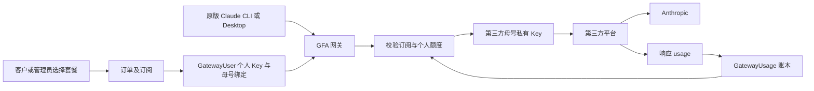

# Claude 拼车业务逻辑与上游迁移说明

日期：2026 年 11 月 11 日。读者：运营负责人、上游平台开发者与迁移实施人员。

代码基线：`456c337c45b095045e99e37179a82b7b4cec8b3e`，包含 Claude 转发修复 `732451b1`。本文区分当前代码行为与新平台的实现建议；迁移对象是第三方母号网关，不是已退役的 Claude OAuth 老号池。

目标：取消冰茶客户端和 GFA 服务对 Claude 拼车的运行依赖，由上游平台完成用户开通、订阅有效期、母号绑定、个人限额、用量结算和访问控制。仅把所有用户改成使用同一把母号 Key，不能保留当前拼车权益和隔离规则。

## 一 迁移结论

必须迁移的核心链条是：客户 → 有效订阅 → 个人调用凭证 → 固定母号绑定 → 双窗口额度检查 → 模型调用 → 用量账本。订单和套餐目录决定权益，母号代表共享供给，二者不可混为一张“剩余次数”表。

新平台可以删除 GFA 这一层 HTTP 转发，但必须在上游实际调用模型之前完成原来由 GFA 执行的资格和个人额度校验。如果现有上游只能发母号 Key、没有子用户额度和到期控制，需要先补这些功能才能关闭冰茶。

建议首版直接在上游实现以下能力：

1. 一个客户拥有独立 Key，可禁用、轮换、设置有效订阅和查看用量。
2. 多个客户绑定同一母号；正常调用不随意切换母号。
3. 个人 5 小时和 7 天美元折算额度，与母号自身额度同时生效。
4. 用量按请求、订阅和母号归属保存，可解释扣费和重置。
5. 订阅发放、续费、取消、到期和人工调整有明确状态及审计。
6. CLI 通过上游域名和个人 Key 接入；服务端保管母号凭证。

## 二 当前运行链路



当前推理入口为 `/api/gateway/v1/messages`，计数入口为 `/api/gateway/v1/messages/count_tokens`。CLI 使用用户自己的网关 Key；GFA 在服务端换成绑定母号的私有 Key，再调用第三方 `/v1/messages`。一个母号目前只从上游申请一把私有 Key，GFA 的多个用户在本地分账，不是在上游为每位客户分别申请一把 Key。

运营控制面默认域名为 `https://pool1.tk4me.com`，每个母号可单独设置推理地址和运营 Key。母号未配置单独运营 Key 时，控制面地址与运营 Key 回退到全局设置；不能假定“修改单个母号推理地址”同时修改了所有控制面请求目的地。

CLI 与 Desktop 共享同一个客户的 GatewayUser 和账本。Codex 属于另一条产品链，不属于本次迁移范围。

## 三 核心实体及对应关系

| 现有实体 | 业务意义 | 上游迁移要求 |
| --- | --- | --- |
| Customer | 客户身份、邮箱、启用状态 | 保留稳定客户映射，停用后禁止使用 |
| PlanCatalog | 可发布版本的套餐价格和每席额度 | 导入当前发布版，保留版本号或等价历史记录 |
| PlanOrder | 付费、赠送、余额、激活码的订单来源 | 保留外部订单 ID、金额、状态和订阅关联 |
| Subscription | 客户买了什么、起止时间、优先级、额度配置 | 每条独立迁移，不能只复制客户最终一个余额 |
| GatewayMotherAccount | 上游账号、私有 Key、状态、模型、额度快照 | 映射到上游自身的母号实体 |
| GatewayUser | 一客户一绑定、一把个人网关 Key | 映射为上游子用户及其独立凭证 |
| GatewayUsage | 请求级 Token 和美元折算账本 | 保留请求、订阅、母号归属及价格版本 |
| 审计记录 | 谁分配、换号、重置、改额度或停用了谁 | 新系统应继续记录 |

`GatewayUser.customerId` 唯一，因此一个客户当前只有一个网关绑定，即使他有多份 Claude 订阅，也共用该母号和 Key。`Subscription.config.bindings.anthropic` 属于历史租号表示，当前第三方链路的母号真相源是 `GatewayUser.motherAccountId`。迁移时不要用旧的数字账号 ID 替代第三方母号 ID。

## 四 套餐席位和母号人数不是同一个值

当前存在三个容易混淆的数字：

| 字段 | 实际含义 | 是否直接决定个人额度 |
| --- | --- | --- |
| `Subscription.config.shareSeats` | 客户购买的席位数，常见 1、2、4、8 | 是，乘套餐每席额度 |
| `GatewayUser.shares` | 当前第三方绑定逻辑固定为 1，即一个用户名额 | 否 |
| `GatewayMotherAccount.totalShares` | 母号参考容量，用于选号排序 | 否，也不是分配硬上限 |

个人额度计算：`个人 5h 限额 = 对应等级每席 5h 额度 × 购买席位数`；每周同理。运行时读取订阅中已经展开的 `usdQuotaByProduct.anthropic`，不再乘 GatewayUser.shares，也不再除以母号人数。

套餐售价另行计算：`floor(所选产品整号等级价格之和 × 席位数 / shareCapacity) + 席位附加价 + 额外设备附加价`。价格存储单位是人民币分；额度单位是按模型 API 价格折算的美元，两者不能相加或互换。

代码里的 `exclusive` 或“8/8 席”不能等同于当前第三方母号真正独占。第三方选号不按等级、购买席位或 exclusive 筛选；如新平台要承诺独享，应新增真实排他约束并单独验收。

### 当前发布配置快照

2026 年 11 月 11 日北京时间 22:13 只读核对：套餐目录版本 35，默认有效期 30 天。

| Claude 等级 | 每席 5h 额度 USD | 每席 7d 额度 USD |
| --- | ---: | ---: |
| Pro | 16 | 150 |
| Max 5x | 20 | 200 |
| Max 20x | 36 | 190 |

以上是当前运营配置，不是 Anthropic 官方承诺，也不是源码中的初始化默认值。Max 5x 的每周配置高于 Max 20x，迁移时应按现有权益核对，不能自行按名称调整。新平台应让运营明确确认这些值。

例：购买 Max 20x 的 2 席，个人限额为 72 USD/5h、380 USD/7d，但当前 GatewayUser 仍只计一个绑定名额。即使母号参考容量为 6，也不是给此用户母号剩余额度的 2/6。

同一时点：1 个第三方母号且为启用 ready，参考容量 6；2 个网关用户；184 条网关账单；11 条时间有效且状态 ACTIVE、配置包含 Claude 的订阅。最后一个数量没有进一步排除停用客户，不等于 11 个可调用用户。这些数量应在正式切换时重新核对，不是迁移文件的固定值。

## 五 开通和订阅生命周期

### 发放与分配

1. 从已发布套餐计算配置和价格快照，建立订单。管理员赠送建立金额为 0 的 PAID/GRANT 订单，仍保留订单链。
2. 开通或延长订阅，写入 startsAt、expiresAt、产品、等级、席位、设备数及美元额度。
3. 后台手动发放 Claude 订阅后调用 `ensureAssigned`。新用户创建绑定及 Key；老用户沿用母号、Key、账单和停用状态。
4. 分配失败时，订阅仍可能已成功生效。返回“需补分配”，不能诱导再次发放而重复延长有效期。

购买前的 Claude 供给预检只检查至少存在启用、ready、持有私有 Key 的第三方母号，不再查询老 OAuth 号池。它不按母号套餐等级匹配，也不保证真实上游此刻一定有余额。

**当前缺口：** `ensureAssigned` 的调用明确位于管理员手动发放流程。支付回调、余额购买、激活码和对账补激活共用订阅激活服务，但该公共服务本身没有统一执行第三方绑定；客户端 activate 也不会替未绑定用户自动建绑定。新平台应将“订阅成功 → 幂等创建或复用子用户绑定”统一接入所有开通渠道。

### 自动选号

- 候选为启用且 ready 的母号；指定母号时只在指定记录中选择。
- `参考空位 = totalShares - 绑定用户数量`，按空位最多优先，平局按 ID 排序。
- 统计包含已停用或订阅已失效但绑定尚未删除的用户。
- 所有母号满额时，仍选择超配最少的一台；没有硬性人数上限。
- 当前没有按模型、等级、实时余量或独享标签进行分配筛选。
- 续费保留原绑定；原母号失效时需要管理员换号，不自动寻找替代母号。

迁移建议：保留固定绑定，但把参考容量与硬性销售上限分开。是否允许超配应成为明确运营规则，不能由字段名称隐含决定。

### 续费与多订阅

同配置 ACTIVE 订阅通常延长到期时间：`新到期 = max(现在, 原到期) + 本次天数`。不同配置新建并存；激活码使用 forceNew，每次建立独立订阅。配置相同的判断主要包含产品、等级、席位和设备数，不包含分配结果，也不是完整 JSON 相等。

续费会采用新购买配置，同时保留原绑定相关字段；不会清除历史用量。个人额度覆盖与旧起止时间绑定，续费后失效，回到套餐配置。发布新目录还会重算当前有效绑定订阅的 USD 额度并保留用量，不是仅影响新订单。

每次推理实时检查客户 ACTIVE、订阅 ACTIVE、开始时间已到且尚未到期；永久订阅允许 expiresAt 为空。所有有效 Claude 订阅按 priority、startsAt、id 升序遍历，选择第一条当前可用的订阅，整次请求记在这条订阅上。不是把多份额度合并成一个余额，也不是跨订阅拆分一次请求。

取消或自然到期后不能继续调用。每小时到期任务主要同步状态；热路径已经检查时间，不应等待定时任务才停服。失效不会自动删除网关用户、Key 或历史账单，续期可复用绑定。

## 六 双窗口限额

### 个人窗口

额度真相源是 `Subscription.config.usdQuotaByProduct.anthropic.{fiveHour,weekly}`，以及有效的 `gatewayQuotaOverride`。管理员覆盖中的 null 表示跟随套餐，0 表示关闭该个人窗口限额，正数是上限。覆盖仅在记录的 startsAt、expiresAt 与当前订阅周期相同时生效。

必须区分 0、缺失和未知：0 是个人不限额；缺失、负数或非法数值属于配置无效，当前不会自动发放无限额度。源码当前热路径不再使用“份数 × shareUsd”的旧兜底。

5h、7d 同时独立检查。任一有限窗口已用达到上限，拒绝请求。关闭个人窗口不等于绕过上游限制。

### 周期边界

有已确认的母号 resetAt 时，个人窗口对齐母号：从 `max(订阅 startsAt, resetAt - 窗口时长)` 到 resetAt，结束边界不包含在统计内。已知边界过期但尚未得到下一周期可信读数时，不按本机时间推断上游已经恢复。

没有母号边界时，以订阅 startsAt 为锚点按 5h 或 7d 分段。这是固定分段，不是每次请求回看最近 5 小时的滑动窗口，也不是从用户每次首次请求重新起算。

人工重置记录 `quotaResetAt`，统计起点再与该时间取最大值；当前这个重置同时影响两个个人窗口，历史累计和账单保留。新平台若要单独重置 5h 或 7d，需要独立字段，不能只复用一个时间。

### 上游窗口

GFA 读取上游账号级 `unified5h`、`unified7d`，不是把私有 Key 校准账本直接当个人额度。账号 enabled、快照时间、真实观测 seenAt、resetAt、remaining 等需要联合判断。当前本地快照有效期 120 秒，账号原始观测最大年龄 600 秒；读取快照的时间不能冒充真实观测时间。

只有明确的新窗口证据才触发母号周期更新：已跨越旧边界，真实观测时间也跨越旧边界，且新 resetAt 比旧值大超过 60 秒。不能看到毫秒抖动就清零，也不能因没有读数认定为无限额。

当前准入策略是：个人额度仍严格检查；上游已确认耗尽则拒绝；上游 unknown 或 uncertain 本身不单独禁止调用，由上游自己的准入继续判断。此策略用于避免旧的不确定状态阻止上游重新校准，不能解释成“未知就是还有余额”。

### 账本统计

个人窗口用量从 GatewayUsage 的 costUsd 聚合，按 gatewayUserId、subscriptionId 和发生时间过滤。优先使用 occurredAt，老记录缺该字段才回退 createdAt。无 subscriptionId 的旧记录只归入当前排序第一条有效 Claude 订阅，防止在多份订阅下重复扣除。

迁移必须保留当前周期已经发生的消耗，否则迁移等于给所有客户补满；只复制累计 totalUsedUsd 也不够，因为无法重建 5h 与 7d 各自用量。

## 七 模型请求与计费

当前准入顺序概括为：个人 Key → 网关用户启用 → 客户及订阅有效 → JSON 正文存在 → 模型与价格可用 → 选择额度可用的订阅 → 并发限制 → 母号可用及模型允许 → 上游调用。

每个用户最多 4 个进行中的请求，使用单进程内存计数；超时 10 分钟。余额是完成后结算，没有请求前的金额预占，因此多个并发请求可能一起通过而最终超过余额。迁移成多实例服务时必须改用共享并发计数；若承诺绝不超额，还要实现额度预占和结束结算。

### 请求保真约定

| 内容 | 当前行为 |
| --- | --- |
| JSON 内容 | 使用原始正文缓冲区，不重排、裁剪或重新序列化提示词、工具、metadata |
| 查询参数 | 保留原编码、顺序、重复值及 `?beta=true` |
| CLI 业务头 | 保留 UA、Beta、API 版本、SDK 信息及新字段，不用固定业务头白名单 |
| 认证 | 移除用户入站认证，换成绑定母号的 Bearer Key |
| 本地信息 | 移除 Cookie、x-gfa-*、x-bcai-*、Forwarded、X-Forwarded-*、X-Real-IP 等 |
| HTTP 传输 | 重建 Host、长度和逐跳字段；压缩请求解压后转发，不保证压缩前字节一致 |
| 自动附加 | 客户端缺 Content-Type 时有 application/json 兜底；不自动补 UA 或 Beta |
| 重试与换号 | 网关不自动重试、不跟随重定向、不在请求失败时换母号 |

Caddy 的网关 transport 已设置 `compression off`，避免自动添加客户端没有发送的 Accept-Encoding。普通 HTTPS 重新建连仍存在；请求内容保真不等于保留客户端 TLS 握手。

新平台应在模型入口继续遵守最小改写原则。运营查询和模型列表查询是服务器自己创建的请求，并不是用户 CLI 请求，不受“逐字复制 CLI”这一说法覆盖。

### 响应与账单

成功 SSE 按原数据转发并只读观察 message_start、message_delta 中的 usage；不拼接新的模型内容。处理背压，缺终止事件或读取异常时断开响应，避免把截断当完成。客户端断开时中止上游。

计费 Token 分为普通输入、输出、缓存读取、5 分钟缓存写入、1 小时缓存写入。按请求发生时的模型价格快照折算 USD，考虑标准/优先模式和长上下文价格。这个数字是用户额度消耗口径，不等于上游实际扣费或 Anthropic 实际账单；优先模式由请求 speed/service_tier 判定。

GatewayUsage 保存 requestId、用户、母号、订阅、请求时间、请求模型、各类 Token、价格版本、价格模式、costUsd 和 HTTP 状态。明细写入和用户累计增加处于同一数据库事务；requestId 唯一，同 ID 重记不重复扣费。但客户端重新发起的请求会生成新 ID，并不天然具备业务去重。

当前只有推理请求且观察到非零 Token 时才落账；count_tokens 不计费。HTTP 非 2xx 的 costUsd 为 0，通常没有 Token 因而也没有这条账单。HTTP 200 的 SSE 中途失败，只要已观察到 Token，仍可能按已知 Token 记账。不能用账单条数代替全部上游请求数量。

错误响应保留 HTTP 状态和部分重试/诊断头，但正文会脱敏改写，限额校准错误有单独提示。并不是所有响应字段都原样透传；错误文字改写可能影响 CLI 的自动兼容重试识别。新平台应保留结构化错误码和必要错误语义，同时过滤真实凭证。

当前按请求模型计价；若上游返回了不同实际模型，需要新平台明确采用请求模型还是响应模型计价。持久化失败目前记录日志，没有可靠补偿队列。迁移建议增加调用审计、持久化重试及对账任务，避免只有成功且非零用量才可追踪。

## 八 密钥和客户端接入

母号私有 Key 与运营 Key 使用 AES-256-GCM 加密，主密钥 `GATEWAY_KEY_KEK` 在环境中；数据库密文脱离主密钥无法迁移使用。用户 Key 为随机 `gfa-` 凭证，数据库保留 SHA-256 用于鉴权，并保留密文供本人托管接口取回。后台列表只显示尾号。

用户 Key 可以轮换，管理员停用与订阅失效分开管理。当前 Key 解析缓存 60 秒，本实例管理操作主动清缓存；多实例部署需要统一失效通知，不能默认跨进程立即撤销。

冰茶客户端只是取得个人 Key、补丁修改 CLI 配置并可恢复原值，不是当前 Claude 计费入口。它设置 ANTHROPIC_BASE_URL、ANTHROPIC_AUTH_TOKEN，清除冲突认证和 Foundry 配置，移除不支持的显式模型覆盖。其他 hooks、插件和权限配置尽量保留。

迁移后交付给客户的最小配置示例：

```json
{
  "env": {
    "ANTHROPIC_BASE_URL": "https://<新上游的模型网关地址>",
    "ANTHROPIC_AUTH_TOKEN": "<该客户自己的子用户 Key>"
  }
}
```

上线说明还要提醒客户处理冲突的 ANTHROPIC_API_KEY/其他提供方配置，并重启相关 CLI 会话。不要下发运营 Key，也不要向所有客户分发同一母号私有 Key。Desktop 使用自己的第三方网关配置，不能假定修改 CLI 配置会自动覆盖 Desktop。

虽然订阅里保存 deviceLimit，当前网关凭证调用本身没有逐请求设备身份核验，只限制每用户并发。因此“购买一台设备”不等于当前裸 Key 无法在其他设备使用。新平台若需要设备限制，必须独立设计及验收。

## 九 已使用的上游接口与待确认能力

以下是当前代码实际使用的接口，不代表上游全部能力：

| 方法与路径 | 认证及用途 |
| --- | --- |
| POST `/teamclaude/ops/tools/provision_private_keys` | 运营 x-api-key；body 为 account、可选 accountId、固定 requestId、people:1 |
| GET `/teamclaude/ops/account-usage?account=...` | 运营 x-api-key；获取母号账号级窗口 |
| GET `/v1/models` | 母号 Bearer Key；模型发现 |
| POST `/v1/messages` | 母号 Bearer Key；推理 |
| POST `/v1/messages/count_tokens` | 母号 Bearer Key；计数 |

申请私有 Key 使用稳定 requestId 实现上游幂等；领取窗口过期且未保存 Key 时记录 key_lost，需要上游轮换。删除 GFA 母号只删除本地对象，不自动撤销上游 Key。关联用户存在时还受数据库关系约束，删除网关用户会级联删除其用量；迁移不能靠删除旧用户“清理现场”。

后台刷新频率：额度每 5 分钟定时同步，推理或面板读取在距上次尝试超过 30 秒时可按需同步并合并并发；手动全量刷新 10 秒内去重。模型启动时补拉超过 6 小时的旧缓存，定时 6 至不足 12 小时，激活时按需刷新且通常复用 10 分钟缓存。因此没有用户推理时，也可能存在运营查询请求。

在新上游上开始实施前，逐项确认：

- 能否一客户一 Key、Key 绑定固定母号、单独禁用与轮换？
- 能否同时执行个人 5h/7d USD 限额与母号总限制，而不仅是把额度按人数均分？
- 能否精确设置到期时间、导入期初用量、调整额度但不重置已用？
- 是否提供请求级 usage、缓存分类、发生时间、错误码及可幂等消费的事件 ID？
- 是否支持多订阅优先级，或需要先限制为一客户一订阅？限制会改变哪些现有权益？
- 控制面开多把私有 Key 的 people 参数究竟如何分配额度，能否匹配本节业务规则？当前代码只使用 people:1，不能据此推断 people:N 已满足完整拼车需求。

## 十 推荐的新平台数据契约

以下是目标结构建议，字段名不要求与 GFA 相同，但语义要明确：

| 对象 | 必须保存的语义 |
| --- | --- |
| customer | 原客户 ID、目标客户 ID、邮箱、启用状态 |
| subscription | 原订阅 ID、客户、产品等级、席位、优先级、起止时间、状态、5h/7d 限额、覆盖及适用周期 |
| membership | 客户与母号固定绑定、启用状态、个人 Key 哈希/密文或目标凭证 ID |
| mother | 稳定上游账号 ID、可用状态、模型、总供给窗口、参考容量与可选硬上限 |
| usage_event | 唯一事件 ID、客户、订阅、母号、请求发生时间、Token 分类、价格版本与模式、USD 消耗、状态 |
| quota_adjustment | 调整类型、窗口、金额或生效截断时间、原因、操作者、时间 |
| order | 来源订单 ID、金额及币种、支付/赠送渠道、状态、权益快照、订阅关联 |
| migration_map | 来源实体 ID 与目标实体 ID、迁移批次、导入状态、校验摘要 |

请求准入伪代码：

```text
验证个人 Key，确认客户与 membership 启用
加载有效 Claude 订阅，按优先级排序
确认绑定母号可用、请求模型可用
对每个订阅：
  解析本周期限额及人工覆盖
  确定 5h/7d 边界，汇总对应账本
  若个人窗口未满且母号未被确定为耗尽：选中该订阅
没有选中项则返回有语义的拒绝及可信恢复时间
取得共享并发名额；若采用严格金额上限则预占额度
使用绑定母号调用，尽量保持发送方业务字段
结束时记录事件并结算，释放并发与预占
```

禁止在前端做最终额度判定，禁止只依靠定时任务停用过期用户，禁止由客户端自报 Token 作为唯一计费依据。

## 十一 迁移步骤和数据处理

1. **确认目标功能。** 完成上一节能力核对，明确超配、独享、设备限制、多订阅和错误透传的目标行为；保持现状或修复缺口都要写成可验收规则。
2. **准备导出器。** 从生产库按 Claude 相关客户导出订阅、订单、绑定、母号映射、用量、价格快照和人工重置。一个组合套餐可能同时含 Codex，迁移时只抽取 Claude 权益，保留原套餐和订单映射，避免把整单误迁或重复退款。
3. **预演导入。** 在隔离环境用合成 Key 和模拟上游运行规则测试。重复导入同一批次应无新增用户、订阅或扣费。
4. **客户和母号映射。** 使用稳定 ID，邮箱只作辅助匹配。有订阅但没有网关绑定的客户单独列为待分配，不能漏掉；已停用客户也不能被导入为启用。
5. **迁移有效期及额度。** 保留绝对起止时间与已用消耗；不得从迁移日重新计算 30 天、5h 或 7d。导入人工覆盖的适用周期和 quotaResetAt。
6. **迁移凭证。** 优先签发新的个人 Key 并交付客户。若要兼容旧 Key，必须确认目标支持原凭证验签/哈希导入或受控的解密重加密。密钥通过专用秘密通道迁移，文档和代码仓库不携带实际值。
7. **安排单次切换。** 停止旧入口接收新请求，等待或明确终止在途请求，记录截止时间 T；导出最后增量账单并对账，再启用新入口。无需长期双系统运行，但不能两个入口各自独立发放完整余额。
8. **更新客户端。** 分发新 Base URL 和个人 Key，分别验证 CLI、Desktop；如果要兼容旧域名，必须明确 DNS、证书和路径由谁接管。
9. **验收和回退。** 对比人数、订阅、窗口余额、已用总额与事件数。回退前停止新入口并补回切换后的新账单，不能直接启用旧入口导致漏扣。
10. **下线旧 Claude 服务。** 停止旧网关和上游轮询、撤销不再需要的运营及私有 Key；保留受限访问的账单备份与映射。Codex 和其他产品若仍使用冰茶，不应随 Claude 迁移一起停服。

推荐导出数据分为 customers、subscriptions、orders、memberships、mother_map、usage_events、pricing_snapshots、quota_adjustments、migration_manifest。manifest 保存截止时间、来源版本、各表数量和校验摘要。敏感凭证另走受控通道。

若无法导入完整历史账本，可建立明确标记的“期初消耗”记录，分别携带 5h/7d 窗口起止和已用金额；这种记录必须与真实请求事件区分，不能同时重复计入历史明细。原历史仍要归档供客户对账。

## 十二 必须通过的验收案例

| 场景 | 预期 |
| --- | --- |
| 新客户获得 Claude 订阅 | 各开通渠道均自动获得一次绑定和个人 Key |
| 同配置续费 | 延长时间，不换号、不换 Key、不清除已用 |
| 不同配置或 forceNew | 多订阅并存，不误取消其他产品 |
| 第一份订阅已满、第二份可用 | 使用第二份并记在其 subscriptionId |
| 5h 满、7d 未满 | 拒绝；恢复只解除 5h 限制，周消耗保留 |
| 个人 5h 为 0 | 不限制个人 5h，仍执行周限制与母号限制 |
| 配置缺失、上游读数未知 | 缺失配置不当无限；未知读数不显示假满额 |
| resetAt 抖动或陈旧读数 | 不重复清零、不按本机时间虚构恢复 |
| 客户停用、Key 轮换、订阅取消/到期 | 不能凭旧缓存继续调用；分布式失效可验证 |
| 指定母号、母号停用、人工换号 | 路由与策略一致，不静默跨号 |
| 同事件重复提交账单 | 只扣一次；不同真实请求正常计费 |
| gzip、重复查询参数、新 Beta 头 | 解压后的正文和业务字段保持正确 |
| SSE 断流、错误事件、客户端取消 | 不伪装成功完成；账单按明确规则结算 |
| 同用户多并发、多实例 | 共享并发上限有效；预占策略防超额或明确允许范围 |
| 迁移后首次请求 | 继承当前周期消耗，不补满也不重复扣除 |
| CLI 与 Desktop 同时调用 | 同客户共用权益和账本 |
| 不依赖冰茶运行 | 关闭旧 Claude 入口后仍可完成开通、调用、扣费和到期 |

## 十三 实现入口索引

以下路径均相对仓库根目录，可用于逐项对照：

| 路径 | 关注内容 |
| --- | --- |
| `prisma/schema.prisma` | Customer、Subscription、PlanOrder、GatewayMotherAccount、GatewayUser、GatewayUsage |
| `apps/server/src/leasing/plan-catalog/pricing.ts` | 售价、席位与每席 USD 额度展开 |
| `apps/server/src/leasing/plan-catalog/plan-catalog.service.ts` | 发布目录及同步现有订阅额度 |
| `apps/server/src/leasing/subscription/subscription.service.ts` | 创建、续期、取消、到期 |
| `apps/server/src/leasing/subscription/config-fingerprint.ts` | 同配置续费判断 |
| `apps/server/src/leasing/subscription/entitlement-sync.service.ts` | 历史权益同步；Claude 跳过旧池选号 |
| `apps/server/src/leasing/account/billing/billing.service.ts` | 订单与第三方供给预检 |
| `apps/server/src/leasing/console/customer-admin/customer-admin.service.ts` | 手动发放后幂等绑定及部分成功提示 |
| `apps/server/src/leasing/gateway-pool/gateway-user.service.ts` | 分配、凭证、订阅资格、窗口聚合、记账 |
| `apps/server/src/leasing/gateway-pool/quota-policy.ts` | 个人额度覆盖及续期失效 |
| `apps/server/src/leasing/gateway-pool/quota-windows.ts` | 上游观测、个人窗口和统计范围 |
| `apps/server/src/leasing/gateway-pool/account-usage.ts` | 账号级窗口归一化及观测新鲜度 |
| `apps/server/src/leasing/gateway-pool/upstream-window.ts` | 可信周期转换 |
| `apps/server/src/leasing/gateway-pool/gateway-pool.service.ts` | 母号配置、Key 生命周期、刷新任务 |
| `apps/server/src/leasing/gateway-pool/upstream-client.ts` | 已使用的第三方 API 合约 |
| `apps/server/src/leasing/gateway-pool/gateway-forward.controller.ts` | 推理准入、请求转发、SSE 与错误响应 |
| `apps/server/src/leasing/gateway-pool/gateway-upstream.ts` | 原生 HTTP 传输与压缩处理 |
| `apps/server/src/leasing/gateway-pool/key-vault.ts` | 凭证加密格式 |
| `apps/server/src/leasing/gateway-pool/gateway-user.controller.ts` | 用户配置、重置、换 Key、activate/summary |
| `apps/server/src/leasing/gateway-pool/gateway-pool.controller.ts` | 母号和运营配置管理 API |
| `apps/app/claude_gateway.go` | CLI 配置注入与恢复 |
| `apps/app/claude_desktop_gateway.go` | Desktop 第三方配置 |
| `packages/shared/src/api-pricing.ts` | 模型 Token 到 USD 的折算 |
| `Caddyfile` | 网关传输 compression off |

现有管理 API 前缀为 `/api/console/gateway-accounts` 和 `/api/console/gateway-users`；客户端本人接口为 `/api/app/gateway/activate`、`/api/app/gateway/summary`。模型列表 `/api/gateway/v1/models` 返回绑定母号缓存中且有已知价格的模型，不逐次调用上游。

交接完成标准：上游开发者可凭此文档实现与现有有效客户权益相容的开通、调用和计费流程；运营能逐客户核对原权益和目标权益；客户能在不启动冰茶的情况下使用自己的 Key，且被正确限额和到期停用。
